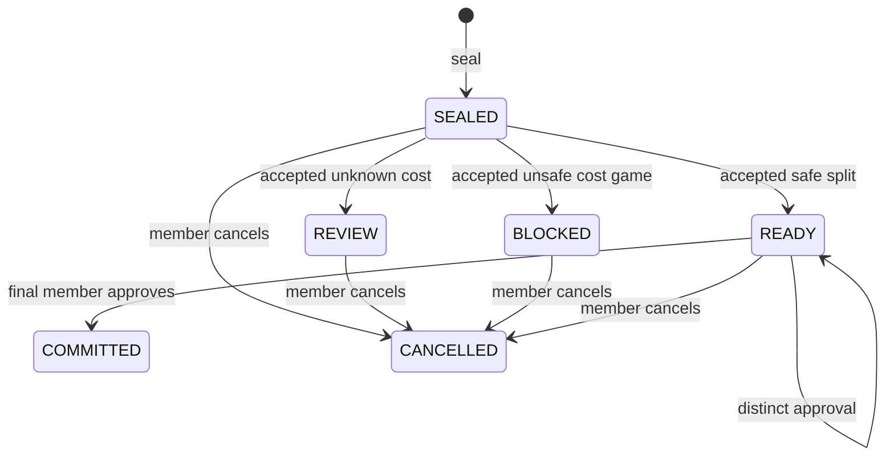

# Protocol sharetally-1

## Immutable input and identity

`seal(tag,payload)` validates an exact JSON schema and creates `<lowercase-owner-address>:<tag>`. Tags use 3–32 lowercase letters, digits or hyphens. The creator must be one of 2–4 distinct nonzero member wallets. Member names are case-insensitively unique. Names, descriptions, quotation and currency cannot change. Replaying the identical normalized input is idempotent; changing input at the same ID fails. Each owner may create at most 24 books.

Quotation length is 20–6000 characters. Title is 3–120, member name 1–50, description 3–240 and optional source locator 0–300. Currency is GBP, USD or EUR; one unit in the table is 0.01 currency units. The locator is stored as a declaration, never fetched or treated as authenticated. Public JSON parsing rejects duplicate keys and oversized input. All state is stored as deterministic canonical JSON in typed TreeMaps.

## State machine

Every non-seal write requires the current exact revision. Seal starts at 0, assessment sets 1, each approval or cancellation increments it. Assessed books cannot be reassessed. COMMITTED and CANCELLED are terminal. Cancellation preserves findings and previous approvals as history; they do not mean the cancelled plan is active.

## Consensus

`gl.vm.run_nondet_unsafe(observe,validator)` is the native GenLayer nondeterministic boundary. Optimistic Democracy, leader rotation, votes, appeal handling and finality are network responsibilities, not locally fabricated votes.

For `n` members the leader returns `2^n-1` rows, ascending masks 1 through `2^n-1`. Bit `i` names member `i`. Every row has KNOWN plus a bounded nonnegative integer cost and exact quote excerpt, or UNKNOWN with null cost and empty quote. The empty coalition is fixed to zero by protocol. A known cost is the complete standalone cost of precisely that subset, not its assigned share of a larger purchase.

The validator rejects non-return results and malformed proposed rows. It independently calls the model over the same original input, without exposing the proposal to that extraction. All masks, labels and costs must match. Quotes can vary but must be literal source excerpts. A second validator model audit checks every proposed quotation anchor, complete price, coalition scope and exact arithmetic against the source. Only the literal JSON boolean `true` with no extra keys passes.

Model exceptions, bad JSON, audit failure and semantic disagreement do not become UNKNOWN. They abort before application state mutation. UNKNOWN represents accepted missing or ambiguous pricing terms. The accepted leader's excerpts are stored; validator prose and transcripts are not manufactured as evidence. Correlated errors remain possible.

## Exact allocation

Let `C(S)` be the accepted total for coalition `S`. If a row is unknown, the book is REVIEW and has no allocation. Before splitting, every one-member superset edge is checked for a price decrease. Any decrease blocks this supported nonnegative-charge model. The product intentionally excludes nonmonotone discount schedules rather than creating negative charges.

For each member `i`, store the integer numerator

`a_i = Σ [ |S|! (n-|S|-1)! (C(S ∪ {i}) - C(S)) ]`, over every `S` not containing `i`.

The denominator is `n!`; the exact Shapley share is `a_i/n!` minor units. Efficiency is checked: `Σ a_i = n! C(N)`. No floating-point arithmetic is used.

Floor every exact share, then allocate remaining minor units to descending fractional remainders. Ties choose lower roster indices. Integer charges are nonnegative and sum exactly to `C(N)`. With `n≤4` and `C≤10^9`, all serialized arithmetic is safely below JavaScript's exact-integer limit.

For every proper nonempty coalition `S`, compare both `Σ a_i` with `n! C(S)` and rounded `Σ charge_i` with `C(S)`. Either strict excess is a blocking witness. Store the coalition mask, standalone cost, exact sum numerator, rounded charge and positive excesses. READY requires no blocker in either representation. This does not search for another core allocation or prove an empty core.

## Signatures and integrity

The allocation hash commits to protocol version, owner-qualified book ID, immutable input hash, all accepted rows including anchors, and the complete derived proof. Approval requires that exact hash and current revision. The caller must be a named wallet and may approve only once. The contract recomputes the proof at every approval. Only the last distinct named approval commits the book.

Transaction signatures bind the destination contract and sender. Allocation digests are not off-chain bearer authorizations and cannot themselves authorize a transaction. There is no admin bypass, payable method, fund transfer or externally executed procurement.
